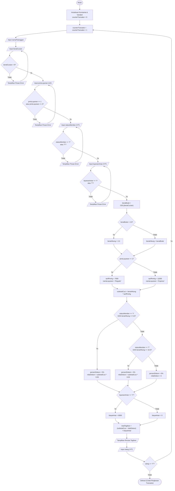

# DOKUMENTASI PROYEK UTS - MODUL A (PROSES UTAMA)
**Mata Kuliah:** Algoritma dan Pengantar Pemrograman (SSI1144)  
**Program Studi:** Sistem Informasi - Fakultas Teknologi dan Desain, Universitas Ma Chung  
**Studi Kasus 02:** Sistem Perhitungan Biaya Laundry  
**Fokus Pengerjaan:** Modul A (Proses Utama, Validasi, Perhitungan Biaya, dan Rincian Tagihan)

---

## 1. Analisis Masalah

### 1.1 Latar Belakang & Deskripsi Masalah
Usaha laundry membutuhkan sistem kasir berbasis terminal/console yang dapat menghitung biaya transaksi laundry secara akurat, konsisten, dan otomatis berdasarkan aturan tarif, pembulatan berat, hak diskon pelanggan, serta biaya tambahan antar jemput. Program harus mampu memvalidasi kesalahan input pengguna dan menyajikan rincian tagihan transparan kepada pelanggan.

### 1.2 Pengguna Program (Target User)
- **Operator Kasir Laundry**: Memasukkan data transaksi cucian pelanggan setiap kali ada pesanan masuk dan mencetak rincian tagihan ke layar.

### 1.3 Ketentuan & Aturan Bisnis
1. **Pilihan Layanan & Tarif Dasar:**
   - Layanan **Reguler**: Rp7.000 per kilogram.
   - Layanan **Express**: Rp11.000 per kilogram.
2. **Aturan Perhitungan Berat:**
   - Berat cucian pecahan dibulatkan ke atas ke bilangan bulat terdekat (contoh: 2.1 kg menjadi 3 kg).
   - Berat cucian kurang dari 2 kg tetap dihitung 2 kg (minimum charge).
3. **Ketentuan Diskon:**
   - **Pelanggan Member**: Jika berat cucian terhitung $\ge 5$ kg, mendapatkan diskon 5% dari subtotal biaya cuci.
   - **Pelanggan Non-Member**: Jika berat cucian terhitung $\ge 10$ kg, mendapatkan diskon 3% dari subtotal biaya cuci.
   - Selain kondisi di atas, diskon adalah 0%.
4. **Layanan Antar:**
   - Layanan antar dikenakan biaya tambahan sebesar **Rp8.000**.
   - Biaya antar **tidak termasuk** komponen yang memperoleh potongan diskon.
5. **Rumus Perhitungan:**
   - $\text{Subtotal Cuci} = \text{Berat Hitung} \times \text{Tarif per kg}$
   - $\text{Nilai Diskon} = \text{Subtotal Cuci} \times \text{Persentase Diskon}$
   - $\text{Total Pembayaran} = (\text{Subtotal Cuci} - \text{Nilai Diskon}) + \text{Biaya Antar}$

### 1.4 Penanganan Input Tidak Valid (Validasi Data)
- Berat cucian bernilai $\le 0$ atau berupa input non-numerik harus ditolak dan diminta input ulang.
- Pilihan layanan selain angka `1` atau `2` harus ditolak.
- Pilihan status keanggotaan dan layanan antar selain `Y`/`y` atau `T`/`t`/`N`/`n` harus ditolak.
- Program tidak boleh berhenti secara tiba-tiba (*crash/infinite loop*).

---

## 2. Analisis Input-Process-Output (IPO)

| Kategori | Data / Operasi | Keterangan |
| :--- | :--- | :--- |
| **Input** | `namaPelanggan` | Nama lengkap pelanggan (teks / string) |
| | `beratCucian` | Berat aktual cucian dalam kilogram (angka desimal / double) |
| | `jenisLayanan` | Jenis layanan cucian: 1 untuk Reguler, 2 untuk Express (integer) |
| | `statusMember` | Status kartu keanggotaan: 'Y' (Ya) / 'T' (Tidak) (karakter) |
| | `layananAntar` | Penggunaan opsi antar jemput: 'Y' (Ya) / 'T' (Tidak) (karakter) |
| | `ulang` | Pilihan pemrosesan transaksi berikutnya: 'Y' / 'T' (karakter) |
| **Process** | Validasi Input | Memastikan data numerik positif dan menu pilihan valid |
| | Pembulatan Berat | `beratBulat = ceil(beratCucian)` |
| | Penerapan Berat Minimum | `IF beratBulat < 2 THEN beratHitung = 2 ELSE beratHitung = beratBulat` |
| | Penentuan Tarif per kg | `IF jenisLayanan == 1 THEN tarif = 7000 ELSE tarif = 11000` |
| | Subtotal Cuci | `subtotalCuci = beratHitung * tarifPerKg` |
| | Evaluasi Diskon | `IF member == 'Y' AND beratHitung >= 5 THEN diskon = 5%`<br>`ELSE IF member == 'T' AND beratHitung >= 10 THEN diskon = 3%`<br>`ELSE diskon = 0%` |
| | Biaya Antar | `IF layananAntar == 'Y' THEN biayaAntar = 8000 ELSE biayaAntar = 0` |
| | Total Akhir | `totalTagihan = (subtotalCuci - nilaiDiskon) + biayaAntar` |
| **Output** | Struk Rincian Tagihan | Nomor transaksi, Nama pelanggan, Status member, Nama layanan, Berat aktual, Berat dihitung, Tarif/kg, Subtotal cucian, Nilai diskon, Biaya antar, Total pembayaran |

---

## 3. Variabel, Konstanta, dan Tipe Data

### 3.1 Tabel Konstanta
| Nama Konstanta | Tipe Data | Nilai | Kegunaan |
| :--- | :--- | :--- | :--- |
| `TARIF_REGULER` | `const double` | `7000.0` | Tarif per kg layanan reguler |
| `TARIF_EXPRESS` | `const double` | `11000.0` | Tarif per kg layanan express |
| `BIAYA_ANTAR` | `const double` | `8000.0` | Biaya tetap jasa antar jemput |
| `MIN_BERAT` | `const double` | `2.0` | Batas minimum berat tagihan (kg) |
| `MIN_BERAT_MEMBER_DISKON` | `const double` | `5.0` | Ambang batas berat diskon pelanggan member |
| `MIN_BERAT_NON_DISKON` | `const double` | `10.0` | Ambang batas berat diskon non-member |
| `PERSEN_DISKON_MEMBER` | `const double` | `0.05` | Besaran diskon member (5%) |
| `PERSEN_DISKON_NON` | `const double` | `0.03` | Besaran diskon non-member (3%) |

### 3.2 Tabel Variabel
| Nama Variabel | Tipe Data | Nilai Awal | Kegunaan |
| :--- | :--- | :--- | :--- |
| `namaPelanggan` | `string` | `""` | Menyimpan nama lengkap pelanggan |
| `beratCucian` | `double` | `0.0` | Menyimpan nilai berat asli dari timbangan |
| `jenisLayanan` | `int` | `0` | Menyimpan pilihan kode layanan (1 atau 2) |
| `statusMember` | `char` | `'N'` | Menyimpan status keanggotaan ('Y' / 'T') |
| `layananAntar` | `char` | `'N'` | Menyimpan pilihan opsi antar ('Y' / 'T') |
| `ulang` | `char` | `'T'` | Menyimpan pilihan perulangan transaksi ('Y' / 'T') |
| `beratBulat` | `double` | `0.0` | Menyimpan hasil pembulatan ke atas berat cucian |
| `beratHitung` | `double` | `0.0` | Berat final yang dikenakan tarif setelah aturan minimum 2 kg |
| `tarifPerKg` | `double` | `0.0` | Tarif per kg yang berlaku sesuai jenis layanan |
| `namaLayanan` | `string` | `""` | Deskripsi teks nama layanan ("Reguler" / "Express") |
| `subtotalCuci` | `double` | `0.0` | Hasil kali `beratHitung` dengan `tarifPerKg` |
| `persenDiskonTampil` | `double` | `0.0` | Persentase diskon untuk ditampilkan di struk (0, 3, atau 5) |
| `nilaiDiskon` | `double` | `0.0` | Besaran diskon dalam bentuk Rupiah |
| `biayaAntar` | `double` | `0.0` | Biaya antar dalam bentuk Rupiah (0 atau 8000) |
| `totalTagihan` | `double` | `0.0` | Total biaya akhir yang wajib dibayarkan pelanggan |
| `counterTransaksi` | `int` | `0` | Menghitung nomor urut transaksi yang diproses |

---

## 4. Algoritma Deskriptif

1. **Mulai Program.**
2. Inisialisasi variabel dan konstanta sistem. Set penghitung transaksi `counterTransaksi = 0`.
3. Masuk ke struktur perulangan transaksi (`do ... while`):
   - Tambah nilai `counterTransaksi` dengan 1.
   - Tampilkan judul transaksi.
   - Masukkan `namaPelanggan`.
   - **Input & Validasi Berat Cucian:**
     - Minta input `beratCucian`.
     - Jika input bukan angka atau `beratCucian <= 0`, tampilkan pesan kesalahan dan ulangi input berat hingga valid.
   - **Input & Validasi Jenis Layanan:**
     - Tampilkan pilihan menu: 1. Reguler, 2. Express.
     - Minta input `jenisLayanan`.
     - Jika `jenisLayanan` bukan 1 dan bukan 2, tampilkan pesan kesalahan dan ulangi hingga valid.
   - **Input & Validasi Status Member:**
     - Minta input `statusMember` (Y/T).
     - Ubah menjadi huruf kapital. Jika bukan 'Y' dan bukan 'T' (atau 'N'), minta input ulang hingga valid.
   - **Input & Validasi Layanan Antar:**
     - Minta input `layananAntar` (Y/T).
     - Ubah menjadi huruf kapital. Jika bukan 'Y' dan bukan 'T' (atau 'N'), minta input ulang hingga valid.
   - **Proses Perhitungan:**
     - Bulatkan `beratCucian` ke atas ke bilangan bulat terdekat simpan pada `beratBulat`.
     - Periksa aturan berat minimum: Jika `beratBulat < 2.0`, maka `beratHitung = 2.0`; jika tidak, `beratHitung = beratBulat`.
     - Tentukan tarif: Jika `jenisLayanan == 1`, maka `tarifPerKg = 7000`, `namaLayanan = "Reguler"`; jika tidak, `tarifPerKg = 11000`, `namaLayanan = "Express"`.
     - Hitung subtotal: `subtotalCuci = beratHitung * tarifPerKg`.
     - Periksa aturan diskon:
       - Jika `statusMember == 'Y'` DAN `beratHitung >= 5.0`: `persenDiskon = 5%`, `nilaiDiskon = subtotalCuci * 0.05`.
       - Jika `statusMember == 'T'` DAN `beratHitung >= 10.0`: `persenDiskon = 3%`, `nilaiDiskon = subtotalCuci * 0.03`.
       - Selain itu: `persenDiskon = 0%`, `nilaiDiskon = 0`.
     - Periksa biaya antar: Jika `layananAntar == 'Y'`, maka `biayaAntar = 8000`; jika tidak, `biayaAntar = 0`.
     - Hitung total tagihan: `totalTagihan = (subtotalCuci - nilaiDiskon) + biayaAntar`.
   - **Tampilkan Rincian Tagihan:**
     - Cetak nomor transaksi, nama pelanggan, jenis layanan, status member, berat asli, berat hitung, tarif/kg, subtotal cucian, nilai diskon, biaya antar, dan total pembayaran.
   - **Evaluasi Perulangan:**
     - Tanyakan kepada kasir apakah ingin memproses transaksi pelanggan lain (Y/T).
     - Validasi jawaban (Y/T).
4. Jika kasir memilih 'Y', kembali ke langkah 3.
5. Jika kasir memilih 'T', tampilkan pesan penutup dan rekapitulasi singkat jumlah transaksi yang berhasil diproses.
6. **Selesai.**

---

## 5. Pseudocode

```text
PROGRAM PerhitunganBiayaLaundry_ModulA

KONSTANTA
    TARIF_REGULER   : real = 7000.0
    TARIF_EXPRESS   : real = 11000.0
    BIAYA_ANTAR     : real = 8000.0
    MIN_BERAT       : real = 2.0
    MIN_MEMBER      : real = 5.0
    MIN_NON_MEMBER  : real = 10.0
    DISKON_MEMBER   : real = 0.05
    DISKON_NON      : real = 0.03

DEKLARASI VARIABEL
    namaPelanggan       : string
    beratCucian         : real
    jenisLayanan        : integer
    statusMember        : character
    layananAntar        : character
    ulang               : character
    beratBulat          : real
    beratHitung         : real
    tarifPerKg          : real
    subtotalCuci        : real
    persenDiskon        : real
    nilaiDiskon         : real
    biayaAntar          : real
    totalTagihan        : real
    counterTransaksi    : integer

ALGORITMA
    counterTransaksi <- 0

    DO
        counterTransaksi <- counterTransaksi + 1
        
        OUTPUT "Masukkan Nama Pelanggan: "
        INPUT namaPelanggan

        // Validasi Berat Cucian
        REPEAT
            OUTPUT "Masukkan Berat Cucian (kg): "
            INPUT beratCucian
            IF beratCucian <= 0 THEN
                OUTPUT "Error: Berat cucian harus > 0!"
            ENDIF
        UNTIL beratCucian > 0

        // Validasi Jenis Layanan
        REPEAT
            OUTPUT "Pilih Jenis Layanan (1. Reguler / 2. Express): "
            INPUT jenisLayanan
            IF jenisLayanan != 1 AND jenisLayanan != 2 THEN
                OUTPUT "Error: Pilihan layanan harus 1 atau 2!"
            ENDIF
        UNTIL jenisLayanan == 1 OR jenisLayanan == 2

        // Validasi Status Member
        REPEAT
            OUTPUT "Apakah Pelanggan Memiliki Kartu Member? (Y/T): "
            INPUT statusMember
            statusMember <- UPPERCASE(statusMember)
            IF statusMember != 'Y' AND statusMember != 'T' THEN
                OUTPUT "Error: Masukkan Y atau T!"
            ENDIF
        UNTIL statusMember == 'Y' OR statusMember == 'T'

        // Validasi Layanan Antar
        REPEAT
            OUTPUT "Gunakan Layanan Antar (+Rp8.000)? (Y/T): "
            INPUT layananAntar
            layananAntar <- UPPERCASE(layananAntar)
            IF layananAntar != 'Y' AND layananAntar != 'T' THEN
                OUTPUT "Error: Masukkan Y atau T!"
            ENDIF
        UNTIL layananAntar == 'Y' OR layananAntar == 'T'

        // Logika Pembulatan dan Aturan Minimum
        beratBulat <- CEIL(beratCucian)
        IF beratBulat < MIN_BERAT THEN
            beratHitung <- MIN_BERAT
        ELSE
            beratHitung <- beratBulat
        ENDIF

        // Penentuan Tarif
        IF jenisLayanan == 1 THEN
            tarifPerKg <- TARIF_REGULER
        ELSE
            tarifPerKg <- TARIF_EXPRESS
        ENDIF

        // Perhitungan Subtotal
        subtotalCuci <- beratHitung * tarifPerKg

        // Penentuan Diskon
        IF statusMember == 'Y' AND beratHitung >= MIN_MEMBER THEN
            persenDiskon <- 5.0
            nilaiDiskon <- subtotalCuci * DISKON_MEMBER
        ELSE IF statusMember == 'T' AND beratHitung >= MIN_NON_MEMBER THEN
            persenDiskon <- 3.0
            nilaiDiskon <- subtotalCuci * DISKON_NON
        ELSE
            persenDiskon <- 0.0
            nilaiDiskon <- 0.0
        ENDIF

        // Biaya Antar
        IF layananAntar == 'Y' THEN
            biayaAntar <- BIAYA_ANTAR
        ELSE
            biayaAntar <- 0.0
        ENDIF

        // Total Tagihan
        totalTagihan <- (subtotalCuci - nilaiDiskon) + biayaAntar

        // Menampilkan Rincian Tagihan
        OUTPUT "===== RINCIAN TAGIHAN LAUNDRY ====="
        OUTPUT "No. Transaksi    : #", counterTransaksi
        OUTPUT "Nama Pelanggan   : ", namaPelanggan
        OUTPUT "Berat Aktual     : ", beratCucian, " kg"
        OUTPUT "Berat Dihitung   : ", beratHitung, " kg"
        OUTPUT "Tarif per kg     : Rp ", tarifPerKg
        OUTPUT "Subtotal Biaya   : Rp ", subtotalCuci
        OUTPUT "Potongan Diskon  : -Rp ", nilaiDiskon
        OUTPUT "Biaya Antar      : Rp ", biayaAntar
        OUTPUT "TOTAL TAGIHAN    : Rp ", totalTagihan

        // Validasi Opsi Perulangan
        REPEAT
            OUTPUT "Proses pelanggan lain? (Y/T): "
            INPUT ulang
            ulang <- UPPERCASE(ulang)
        UNTIL ulang == 'Y' OR ulang == 'T'

    WHILE ulang == 'Y'

    OUTPUT "Program Selesai. Total transaksi: ", counterTransaksi
END PROGRAM
```

---

## 6. Flowchart Logika Modul A


