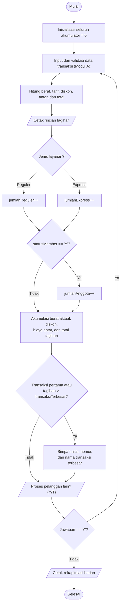

# DOKUMENTASI PROYEK UTS - MODUL B (REKAPITULASI)

**Mata Kuliah:** Algoritma dan Pengantar Pemrograman (SSI1144)  
**Program Studi:** Sistem Informasi - Fakultas Teknologi dan Desain, Universitas Ma Chung  
**Studi Kasus 02:** Sistem Perhitungan Biaya Laundry  
**Fokus Pengerjaan:** Modul B (Akumulasi Data Transaksi dan Rekapitulasi Harian)

---

## 1. Analisis Masalah

Modul B melengkapi Modul A dengan mengakumulasi data setiap transaksi yang telah selesai dihitung. Program tetap menerima transaksi secara berulang dan mencetak rincian tagihan per pelanggan. Setelah kasir berhenti memasukkan transaksi, program menampilkan rekapitulasi seluruh transaksi pada sesi tersebut.

### 1.1 Ketentuan Rekapitulasi

1. **Jumlah pelanggan Reguler dan Express** dihitung dari pilihan layanan pada tiap transaksi.
2. **Jumlah pelanggan anggota** dihitung untuk transaksi dengan status member `Y`.
3. **Total berat cucian** adalah jumlah berat aktual (`beratCucian`) semua transaksi, bukan berat yang dibulatkan untuk penagihan.
4. **Total diskon** adalah jumlah seluruh `nilaiDiskon`.
5. **Total biaya antar** adalah jumlah seluruh `biayaAntar`.
6. **Total pendapatan** adalah jumlah seluruh `totalTagihan` yang dibayarkan pelanggan, termasuk biaya antar dan setelah diskon.
7. **Transaksi terbesar** adalah transaksi dengan `totalTagihan` tertinggi. Rekap mencantumkan nomor transaksi, nama pelanggan, dan nilainya. Jika ada nilai yang sama, transaksi pertama yang mencapai nilai terbesar ditampilkan.
8. Setiap transaksi valid dihitung satu kali, setelah seluruh perhitungan Modul A selesai. Transaksi yang menyebabkan kasir memilih berhenti tetap masuk rekap.
9. Jika tidak ada transaksi, jumlah dan nilai rekap bernilai nol dan transaksi terbesar ditampilkan sebagai belum ada.

### 1.2 Rumus Akumulasi

```text
jumlahReguler       = jumlah transaksi dengan jenisLayanan == 1
jumlahExpress       = jumlah transaksi dengan jenisLayanan == 2
jumlahAnggota       = jumlah transaksi dengan statusMember == 'Y'
totalBeratCucian    = Σ beratCucian
totalDiskon         = Σ nilaiDiskon
totalBiayaAntar     = Σ biayaAntar
totalPendapatan     = Σ totalTagihan
```

Transaksi terbesar diperbarui apabila transaksi pertama diproses atau `totalTagihan > transaksiTerbesar`. Perbandingan ketat ini mempertahankan transaksi pertama jika terdapat nilai tagihan yang sama.

## 2. Analisis Input-Process-Output (IPO)

| Kategori | Data / Operasi | Keterangan |
| :--- | :--- | :--- |
| **Input** | Seluruh data transaksi Modul A | Nama, berat aktual, jenis layanan, status member, dan pilihan antar |
| **Input** | `ulang` | Pilihan kasir untuk memproses transaksi berikutnya |
| **Process** | Perhitungan Modul A | Validasi, pembulatan berat tagihan, tarif, diskon, biaya antar, dan total tagihan |
| **Process** | Hitung pelanggan per layanan | Tambah penghitung Reguler atau Express berdasarkan `jenisLayanan` |
| **Process** | Hitung pelanggan anggota | Tambah penghitung jika `statusMember == 'Y'` |
| **Process** | Akumulasi nilai transaksi | Tambahkan berat aktual, diskon, biaya antar, dan tagihan ke total masing-masing |
| **Process** | Cari transaksi terbesar | Simpan nomor, nama, dan total tagihan jika total saat ini melampaui nilai terbesar |
| **Output** | Rincian tagihan | Dicetak untuk setiap transaksi, mengikuti Modul A |
| **Output** | Rekapitulasi harian | Dicetak sekali setelah perulangan transaksi selesai |

## 3. Variabel Rekapitulasi

Semua akumulator diinisialisasi satu kali sebelum perulangan transaksi dimulai.

| Nama Variabel | Tipe Data | Nilai Awal | Kegunaan |
| :--- | :--- | :--- | :--- |
| `jumlahReguler` | `int` | `0` | Jumlah transaksi layanan Reguler |
| `jumlahExpress` | `int` | `0` | Jumlah transaksi layanan Express |
| `jumlahAnggota` | `int` | `0` | Jumlah transaksi pelanggan berstatus member |
| `totalBeratCucian` | `double` | `0.0` | Akumulasi berat aktual seluruh transaksi (kg) |
| `totalDiskon` | `double` | `0.0` | Akumulasi nilai diskon (Rupiah) |
| `totalBiayaAntar` | `double` | `0.0` | Akumulasi biaya antar (Rupiah) |
| `totalPendapatan` | `double` | `0.0` | Akumulasi seluruh tagihan setelah diskon (Rupiah) |
| `transaksiTerbesar` | `double` | `0.0` | Nilai tagihan terbesar yang ditemukan |
| `nomorTransaksiTerbesar` | `int` | `0` | Nomor transaksi dengan tagihan terbesar |
| `namaPelangganTerbesar` | `string` | `""` | Nama pelanggan pada transaksi terbesar |

Variabel transaksi milik Modul A, termasuk `counterTransaksi`, `jenisLayanan`, `beratCucian`, `statusMember`, `nilaiDiskon`, `biayaAntar`, dan `totalTagihan`, tetap digunakan sebagai sumber data rekapitulasi.

## 4. Algoritma Deskriptif

1. Mulai program dan inisialisasi seluruh variabel Modul A serta akumulator Modul B dengan nilai nol.
2. Masuk ke perulangan transaksi.
3. Ambil dan validasi data pelanggan, lalu hitung transaksi sesuai Modul A.
4. Cetak rincian tagihan pelanggan.
5. Akumulasikan transaksi yang baru selesai:
   - Tambahkan satu ke `jumlahReguler` atau `jumlahExpress`.
   - Jika pelanggan member, tambahkan satu ke `jumlahAnggota`.
   - Tambahkan berat aktual, diskon, biaya antar, dan tagihan ke total masing-masing.
   - Jika transaksi pertama atau tagihannya lebih besar daripada `transaksiTerbesar`, simpan tagihan, nomor transaksi, dan nama pelanggan tersebut.
6. Tanyakan apakah kasir ingin memproses pelanggan lain. Validasi jawaban `Y` atau `T` (huruf kecil juga diterima).
7. Jika jawaban `Y`, kembali ke langkah 3. Jika `T`, keluar dari perulangan.
8. Cetak rekapitulasi seluruh transaksi dan pesan penutup.
9. Selesai.

## 5. Pseudocode

```text
PROGRAM PerhitunganBiayaLaundry_ModulA_dan_ModulB

INISIALISASI
    jumlahReguler <- 0
    jumlahExpress <- 0
    jumlahAnggota <- 0
    totalBeratCucian <- 0
    totalDiskon <- 0
    totalBiayaAntar <- 0
    totalPendapatan <- 0
    transaksiTerbesar <- 0
    nomorTransaksiTerbesar <- 0
    namaPelangganTerbesar <- ""
    counterTransaksi <- 0

    // Jalankan input, validasi, perhitungan, dan cetak tagihan Modul A.
    ULANGI transaksi sampai kasir memilih 'T'

    // Akumulasi dilakukan sekali untuk setiap transaksi yang sudah dihitung.
    JIKA jenisLayanan == 1
        jumlahReguler <- jumlahReguler + 1
    JIKA TIDAK
        jumlahExpress <- jumlahExpress + 1
    ENDIF

    JIKA statusMember == 'Y'
        jumlahAnggota <- jumlahAnggota + 1
    ENDIF

    totalBeratCucian <- totalBeratCucian + beratCucian
    totalDiskon <- totalDiskon + nilaiDiskon
    totalBiayaAntar <- totalBiayaAntar + biayaAntar
    totalPendapatan <- totalPendapatan + totalTagihan

    JIKA counterTransaksi == 1 ATAU totalTagihan > transaksiTerbesar
        transaksiTerbesar <- totalTagihan
        nomorTransaksiTerbesar <- counterTransaksi
        namaPelangganTerbesar <- namaPelanggan
    ENDIF

    // Setelah perulangan selesai:
    OUTPUT jumlahReguler, jumlahExpress, jumlahAnggota
    OUTPUT totalBeratCucian, totalDiskon, totalBiayaAntar, totalPendapatan
    JIKA counterTransaksi > 0
        OUTPUT nomorTransaksiTerbesar, namaPelangganTerbesar, transaksiTerbesar
    JIKA TIDAK
        OUTPUT "Belum ada transaksi"
    ENDIF
END PROGRAM
```

Urutan cetak tagihan dan akumulasi dapat ditukar tanpa mengubah hasil; yang penting akumulasi dilakukan tepat sekali setelah transaksi valid selesai dihitung dan sebelum iterasi berikutnya.

## 6. Flowchart Logika Modul B



## 7. Skenario Pengujian Modul B

| No. | Skenario | Data transaksi ringkas | Hasil yang diharapkan |
| :---: | :--- | :--- | :--- |
| 1 | Satu transaksi Reguler, bukan anggota, tanpa antar | Andi, 1.2 kg, Reguler, `T`, antar `T` | Reguler 1; Express 0; anggota 0; berat aktual 1.2 kg; diskon Rp0; antar Rp0; pendapatan Rp14.000; transaksi terbesar #1 Andi Rp14.000 |
| 2 | Campuran layanan, anggota, diskon, dan antar | Andi: 1.2 kg Reguler, non-member, antar; Cantika: 4.5 kg Express, member, tanpa antar; Faisal: 11.2 kg Express, non-member, antar | Reguler 1; Express 2; anggota 1; berat aktual 16.9 kg; diskon Rp6.710; antar Rp16.000; pendapatan Rp210.290; transaksi terbesar #3 Faisal Rp136.040 |
| 3 | Tagihan sama pada transaksi berbeda | Dua transaksi dengan total tagihan yang sama | Nilai terbesar benar; nomor dan nama transaksi pertama yang mencapai nilai tersebut ditampilkan |
| 4 | Mengakhiri transaksi setelah satu pelanggan | Satu transaksi valid, lalu jawab `T` atau `t` | Transaksi tetap masuk seluruh rekap, kemudian program menampilkan rekap dan selesai |
| 5 | Validasi transaksi tidak valid | Masukkan data invalid sebelum data valid | Data invalid tidak menambah akumulator; transaksi hanya dihitung setelah semua input valid dan perhitungan selesai |

### Perhitungan acuan untuk skenario 2

- Andi: berat hitung 2 kg; total tagihan Rp22.000.
- Cantika: berat hitung 5 kg; subtotal Rp55.000; diskon Rp2.750; total tagihan Rp52.250.
- Faisal: berat hitung 12 kg; subtotal Rp132.000; diskon Rp3.960; biaya antar Rp8.000; total tagihan Rp136.040.
- Total pendapatan: Rp22.000 + Rp52.250 + Rp136.040 = **Rp210.290**.
- Total diskon: Rp2.750 + Rp3.960 = **Rp6.710**.
- Total berat aktual: 1.2 + 4.5 + 11.2 = **16.9 kg**.
- Total biaya antar: Rp8.000 + Rp0 + Rp8.000 = **Rp16.000**.

## 8. Trace Table Rekapitulasi

| Setelah transaksi | Layanan | Member? | Berat aktual | Diskon | Antar | Tagihan | Reguler | Express | Anggota | Total berat | Total diskon | Total antar | Pendapatan | Terbesar saat ini |
| :---: | :--- | :---: | ---: | ---: | ---: | ---: | ---: | ---: | ---: | ---: | ---: | ---: | ---: | :--- |
| #1 Andi | Reguler | Tidak | 1.2 kg | Rp0 | Rp8.000 | Rp22.000 | 1 | 0 | 0 | 1.2 kg | Rp0 | Rp8.000 | Rp22.000 | #1 Andi, Rp22.000 |
| #2 Cantika | Express | Ya | 4.5 kg | Rp2.750 | Rp0 | Rp52.250 | 1 | 1 | 1 | 5.7 kg | Rp2.750 | Rp8.000 | Rp74.250 | #2 Cantika, Rp52.250 |
| #3 Faisal | Express | Tidak | 11.2 kg | Rp3.960 | Rp8.000 | Rp136.040 | 1 | 2 | 1 | 16.9 kg | Rp6.710 | Rp16.000 | Rp210.290 | #3 Faisal, Rp136.040 |

> Total pendapatan pada tabel dan perhitungan acuan adalah Rp210.290.

## 9. Integrasi dan Menjalankan Program

Implementasi lengkap Modul A dan B tersedia pada [`src/modul_b.cpp`](../src/modul_b.cpp). Berkas Modul A tetap terpisah dan tidak diubah. Akumulator Modul B harus berada di luar perulangan transaksi agar nilainya tidak kembali nol pada setiap pelanggan.

Kompilasi dan jalankan dari direktori utama proyek:

```bash
g++ -Wall -Wextra -std=c++11 src/modul_b.cpp -o src/modul_b
./src/modul_b
```

Rekap menggunakan berat aktual untuk menggambarkan berat cucian yang masuk. Berat hitung hasil pembulatan/minimum tetap digunakan Modul A untuk biaya transaksi, tetapi tidak dijumlahkan dalam `totalBeratCucian`.